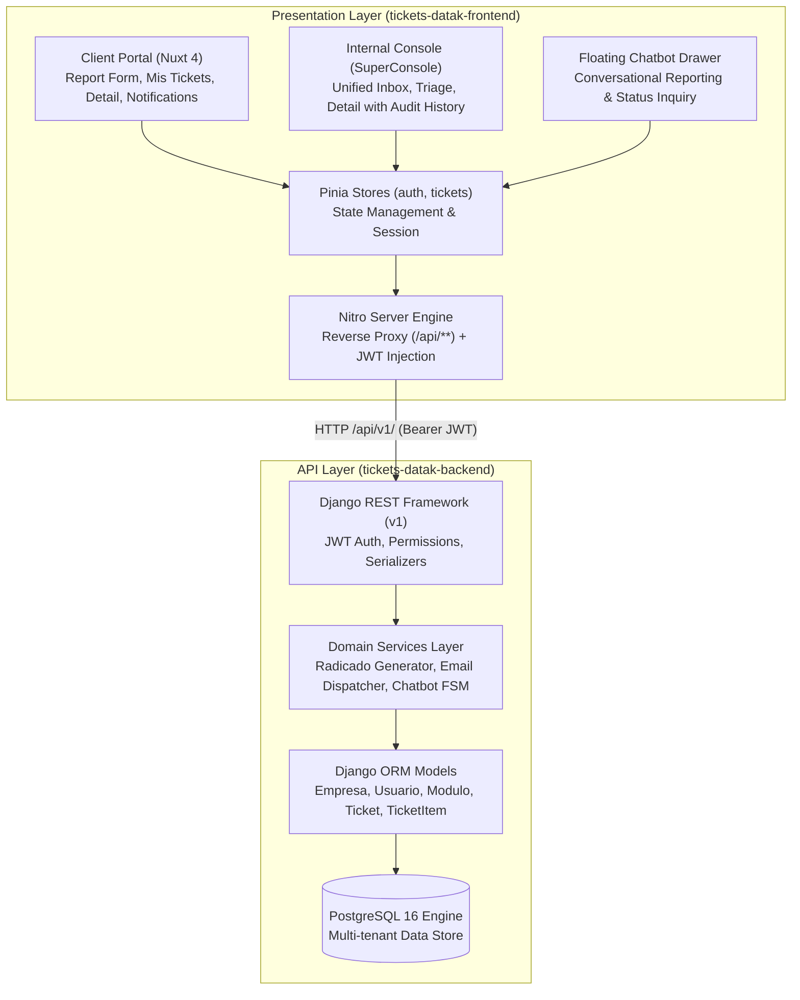
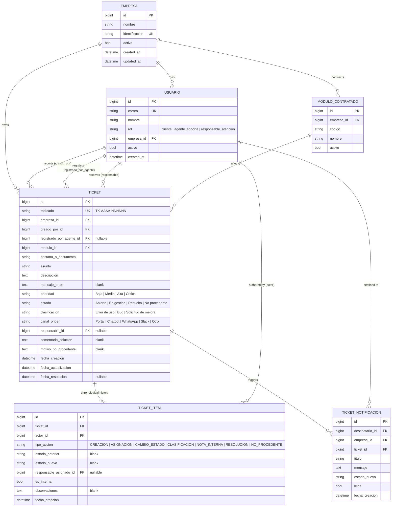
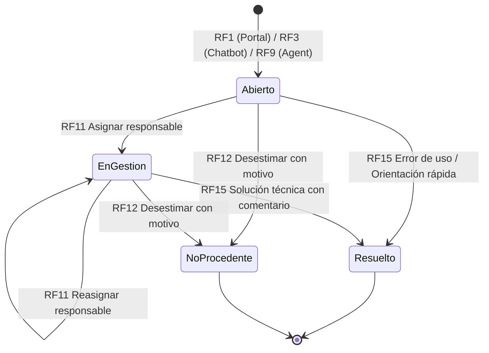

# Technical Architecture, Data Model & API Specification Reference
## Support Ticket Management MVP — API-DATAK

**Target Repositories:**
- Backend API: [`tickets-datak-backend`](https://github.com/AnorakTeam/tickets-datak-backend) (Django 6 + DRF + PostgreSQL 16)
- Frontend Web: [`tickets-datak-frontend`](https://github.com/AnorakTeam/tickets-datak-frontend) (Nuxt 4 + Nuxt UI / Tailwind + Pinia)

---

## 1. System Architecture Overview

The system is designed as a decoupled two-tier web application adhering to clean architectural boundaries:



### Architectural Principles:
1. **Multi-Tenancy by Design (RNF2):** Data isolation is enforced at the company (`Empresa`) level. The client's company is **never** accepted from incoming request payloads; it is strictly deduced on the server from the authenticated JWT (`request.user.empresa`).
2. **Strict Information Hiding (RNF2):** Client-facing serializers **strictly omit** assigned internal staff (`responsable`), estimated hours, and internal notes (`TicketItem.es_interna = True`). Attempting to view a ticket belonging to another company returns **HTTP 404 Not Found** (preventing tenant enumeration).
3. **Audit Trail Immutability (RNF5):** The `TicketItem` model implements append-only event sourcing. Updates (`PUT`/`PATCH`) and deletes (`DELETE`) are strictly forbidden at both the ORM and API levels.
4. **Performance & Pagination (RNF3):** All list endpoints enforce server-side pagination (`page_size=10`), query optimization with `select_related()` and `prefetch_related()`, with targeted latency under 2 seconds.

---

## 2. Relational Data Model (ERD) & Invariants



---

## 3. Detailed Model Definitions & Field Counts

### 3.1 `Empresa` (Tenant Entity)
Multi-tenant boundary representing client companies.
- `id`: `BigAutoField` (Primary Key).
- `nombre`: `CharField(max_length=255)`. (e.g., "Acme Industrial S.A.S.").
- `identificacion`: `CharField(max_length=50, unique=True)`. NIT or corporate tax ID.
- `activa`: `BooleanField(default=True)`.
- `created_at`: `DateTimeField(auto_now_add=True)`.
- `updated_at`: `DateTimeField(auto_now=True)`.

### 3.2 `Usuario` (Custom User Model)
Inherits from `AbstractBaseUser` and `PermissionsMixin`.
- `id`: `BigAutoField` (Primary Key).
- `correo`: `EmailField(unique=True)`. Used as the `USERNAME_FIELD` for authentication.
- `nombre`: `CharField(max_length=255)`. Full name.
- `rol`: `CharField(max_length=30, choices=RolChoices.choices)`.
  - `cliente`: Client representative reporting issues.
  - `agente_soporte`: Internal support agent who triages, categorizes, and logs external tickets.
  - `responsable_atencion`: Product engineer or technical staff assigned to resolve issues.
- `empresa`: `ForeignKey('Empresa', on_delete=models.CASCADE, null=True, blank=True)`. Obligatory for `cliente`.
- `activo`: `BooleanField(default=True)`. Maps to Django's `is_active`.
- `is_staff`: `BooleanField(default=False)`.

### 3.3 `ModuloContratado` (5 Logical Fields)
Licensed functional modules for a client company.
- `id`: `BigAutoField` (Primary Key).
- `empresa`: `ForeignKey('Empresa', on_delete=models.CASCADE)`.
- `codigo`: `CharField(max_length=50)`. (e.g., `FACTURACION`, `INVENTARIO`, `NOMINA`).
- `nombre`: `CharField(max_length=100)`. Human-readable name.
- `activo`: `BooleanField(default=True)`.
- *Constraint:* `UniqueConstraint(fields=['empresa', 'codigo'], name='unique_empresa_modulo')`.

### 3.4 `Ticket` (Exactly 20 Logical Fields — FP8 Range MEDIO)
The central operational entity of the system.
1. `id`: `BigAutoField` (Primary Key).
2. `radicado`: `CharField(max_length=20, unique=True, db_index=True)`. Format: `TK-AAAA-NNNNNN`.
3. `empresa`: `ForeignKey('Empresa', on_delete=models.PROTECT, db_index=True)`.
4. `creado_por`: `ForeignKey('Usuario', related_name='tickets_creados', on_delete=models.PROTECT)`.
5. `registrado_por_agente`: `ForeignKey('Usuario', related_name='tickets_registrados_agente', null=True, blank=True, on_delete=models.SET_NULL)`.
6. `modulo`: `ForeignKey('ModuloContratado', on_delete=models.PROTECT)`.
7. `pestana_o_documento`: `CharField(max_length=255)`. Screen, view, or document where the error occurred.
8. `asunto`: `CharField(max_length=255)`. Brief summary.
9. `descripcion`: `TextField()`. Full explanation of the problem.
10. `mensaje_error`: `TextField(blank=True, default='')`. System error message, stack trace, or screen code.
11. `prioridad`: `CharField(max_length=20, choices=['Baja', 'Media', 'Alta', 'Critica'], default='Media')`.
12. `estado`: `CharField(max_length=30, choices=['Abierto', 'En gestion', 'Resuelto', 'No procedente'], default='Abierto')`.
13. `clasificacion`: `CharField(max_length=30, null=True, blank=True, choices=['Error de uso', 'Bug', 'Solicitud de mejora'])`.
14. `canal_origen`: `CharField(max_length=20, choices=['Portal', 'Chatbot', 'WhatsApp', 'Slack', 'Otro'], default='Portal')`.
15. `responsable`: `ForeignKey('Usuario', related_name='tickets_asignados', null=True, blank=True, on_delete=models.SET_NULL)`.
16. `comentario_solucion`: `TextField(blank=True, default='')`. Solution explanation visible to client.
17. `motivo_no_procedente`: `TextField(blank=True, default='')`. Justification visible to client when marked invalid.
18. `fecha_creacion`: `DateTimeField(auto_now_add=True, db_index=True)`.
19. `fecha_actualizacion`: `DateTimeField(auto_now=True)`.
20. `fecha_resolucion`: `DateTimeField(null=True, blank=True)`. Timestamp when resolved or closed.

### 3.5 `TicketItem` (Exactly 10 Logical Fields — Audit Log / Event Sourcing)
Append-only chronological history.
1. `id`: `BigAutoField` (Primary Key).
2. `ticket`: `ForeignKey('Ticket', related_name='historial', on_delete=models.CASCADE)`.
3. `actor`: `ForeignKey('Usuario', on_delete=models.PROTECT)`. User who performed the action.
4. `tipo_accion`: `CharField(max_length=30, choices=['CREACION', 'ASIGNACION', 'CAMBIO_ESTADO', 'CLASIFICACION', 'NOTA_INTERNA', 'RESOLUCION', 'NO_PROCEDENTE'])`.
5. `estado_anterior`: `CharField(max_length=30, blank=True, default='')`.
6. `estado_nuevo`: `CharField(max_length=30, blank=True, default='')`.
7. `responsable_asignado`: `ForeignKey('Usuario', null=True, blank=True, on_delete=models.SET_NULL)`.
8. `es_interna`: `BooleanField(default=False)`. If `True`, strictly hidden from client responses.
9. `observaciones`: `TextField(blank=True, default='')`. Comments, notes, or orientation message.
10. `fecha_creacion`: `DateTimeField(auto_now_add=True)`.
- *Immutability Invariant:*
  ```python
  def save(self, *args, **kwargs):
      if self.pk is not None:
          raise PermissionDenied("TicketItem records are strictly immutable and cannot be modified.")
      super().save(*args, **kwargs)

  def delete(self, *args, **kwargs):
      raise PermissionDenied("TicketItem records are strictly immutable and cannot be deleted.")
  ```

### 3.6 `TicketNotificacion` (Exactly 9 Logical Fields — Iteration 2)
In-portal client notifications when ticket state changes to `Resuelto` or `No procedente`.
1. `id`: `BigAutoField` (Primary Key).
2. `destinatario`: `ForeignKey('Usuario', related_name='notificaciones', on_delete=models.CASCADE)`.
3. `empresa`: `ForeignKey('Empresa', on_delete=models.CASCADE)`.
4. `ticket`: `ForeignKey('Ticket', on_delete=models.CASCADE)`.
5. `titulo`: `CharField(max_length=255)`. (e.g. "Ticket Resuelto: TK-2026-000012").
6. `mensaje`: `TextField()`. Brief description and solution orientation.
7. `estado_nuevo`: `CharField(max_length=30)`.
8. `leida`: `BooleanField(default=False)`.
9. `fecha_creacion`: `DateTimeField(auto_now_add=True)`.

---

## 4. Ticket Lifecycle State Machine



---

## 5. REST API v1 Contract Specification

All endpoints are hosted under `/api/v1/`. Authentication is delivered via HTTP header:
`Authorization: Bearer <JWT_ACCESS_TOKEN>`

### 5.1 Authentication Endpoints
- **`POST /api/v1/auth/token/`**
  - **Request Body:**
    ```json
    { "correo": "cliente@acme.com", "password": "password123" }
    ```
  - **Response (200 OK):**
    ```json
    {
      "access": "<JWT_STRING>",
      "refresh": "<JWT_STRING>",
      "user": {
        "id": 1,
        "correo": "cliente@acme.com",
        "nombre": "Carlos Gómez",
        "rol": "cliente",
        "empresa": { "id": 1, "nombre": "Acme Industrial S.A.S." }
      }
    }
    ```
- **`POST /api/v1/auth/token/refresh/`**

---

### 5.2 Client Portal Endpoints (Iteration 1)

#### `GET /api/v1/modulos/` (RF2)
Retrieves active contracted modules for the authenticated client's company.
- **Access:** Authenticated `cliente`.
- **Response (200 OK):**
  ```json
  [
    { "id": 10, "codigo": "FACTURACION", "nombre": "Facturación Electrónica" },
    { "id": 11, "codigo": "INVENTARIO", "nombre": "Control de Inventarios" }
  ]
  ```

#### `POST /api/v1/client/tickets/` (RF1)
Creates a new support incident from the web form.
- **Access:** Authenticated `cliente`.
- **Request Body:**
  ```json
  {
    "modulo_id": 10,
    "pestana_o_documento": "Emisión de Facturas / F-203",
    "asunto": "Error 500 al emitir factura electrónica con retención",
    "descripcion": "Al intentar timbrar la factura para el cliente XYZ, el sistema se queda cargando y arroja error de servidor.",
    "mensaje_error": "Server Error: RetencionCalculatorException line 42",
    "prioridad": "Alta"
  }
  ```
- **Response (201 Created):**
  ```json
  {
    "radicado": "TK-2026-000001",
    "estado": "Abierto",
    "fecha_creacion": "2026-11-09T18:30:00Z",
    "asunto": "Error 500 al emitir factura electrónica con retención",
    "modulo": { "id": 10, "nombre": "Facturación Electrónica" },
    "mensaje": "Incidencia radicada exitosamente. Se ha enviado un comprobante a su correo."
  }
  ```

#### `GET /api/v1/client/tickets/?estado=&page=` (RF4)
Lists all tickets belonging to the client's company, sorted with `Abierto` first.
- **Query Params:**
  - `estado` (optional): `Abierto`, `En gestion`, `Resuelto`, `No procedente`.
  - `page` (optional, default `1`).
- **Response (200 OK):**
  ```json
  {
    "count": 24,
    "next": "http://localhost:8000/api/v1/client/tickets/?page=2",
    "previous": null,
    "results": [
      {
        "radicado": "TK-2026-000001",
        "asunto": "Error 500 al emitir factura",
        "modulo_nombre": "Facturación Electrónica",
        "prioridad": "Alta",
        "estado": "Abierto",
        "fecha_creacion": "2026-11-09T18:30:00Z"
      }
    ]
  }
  ```

#### `GET /api/v1/client/tickets/{radicado}/` (RF5)
Detailed ticket view for clients. **Security Guard:** Never returns `responsable` or internal notes.
- **Response (200 OK):**
  ```json
  {
    "radicado": "TK-2026-000001",
    "estado": "Resuelto",
    "prioridad": "Alta",
    "asunto": "Error 500 al emitir factura",
    "descripcion": "Al intentar timbrar la factura...",
    "pestana_o_documento": "Emisión de Facturas / F-203",
    "mensaje_error": "Server Error: RetencionCalculatorException",
    "canal_origen": "Portal",
    "fecha_creacion": "2026-11-09T18:30:00Z",
    "fecha_resolucion": "2026-11-10T14:20:00Z",
    "comentario_solucion": "Se corrigió la regla de validación de retención en la base de datos.",
    "motivo_no_procedente": ""
  }
  ```

---

### 5.3 Chatbot Endpoints (Iteration 1)

#### `POST /api/v1/chatbot/mensajes/` (RF3, RF6)
Conversational interface for incident reporting and ticket status queries.
- **Request Body:**
  ```json
  {
    "session_id": "uuid-or-client-session-token",
    "mensaje": "Quiero reportar un problema en Facturación"
  }
  ```
- **Response (200 OK — Dialogue Step):**
  ```json
  {
    "session_id": "uuid-or-client-session-token",
    "tipo_respuesta": "PREGUNTA",
    "mensaje": "¿En qué pantalla o documento ocurrió el problema?",
    "campos_recolectados": {
      "modulo": "FACTURACION"
    }
  }
  ```
- **Response (200 OK — Final Confirmation with Radicado):**
  ```json
  {
    "session_id": "uuid-or-client-session-token",
    "tipo_respuesta": "TICKET_CREADO",
    "radicado": "TK-2026-000002",
    "mensaje": "He creado tu ticket exitosamente con el radicado **TK-2026-000002**. Nuestro equipo de soporte ya fue notificado."
  }
  ```
- **Response (200 OK — Status Inquiry Query):**
  ```json
  {
    "session_id": "uuid-or-client-session-token",
    "tipo_respuesta": "ESTADO_TICKET",
    "radicado": "TK-2026-000001",
    "datos": {
      "estado": "En gestion",
      "asunto": "Error 500 al emitir factura",
      "fecha_creacion": "2026-11-09"
    },
    "mensaje": "Tu ticket **TK-2026-000001** se encuentra actualmente **En gestión**."
  }
  ```

---

### 5.4 Internal Support Console Endpoints (Iteration 2 Preview)

| Method | Endpoint | Actor | Purpose |
| :--- | :--- | :--- | :--- |
| `GET` | `/api/v1/support/tickets/` | Agente / Resp. | Unified inbox with filters (`empresa`, `estado`, `prioridad`, `canal`). |
| `GET` | `/api/v1/support/tickets/{id}/` | Agente / Resp. | Full ticket detail including complete `TicketItem` audit timeline and internal notes. |
| `POST` | `/api/v1/support/tickets/` | Agente | Create ticket on behalf of a customer (WhatsApp, Slack, phone). |
| `PATCH` | `/api/v1/support/tickets/{id}/clasificar/` | Agente | Assign classification (Error de uso, Bug, Mejora) and priority. |
| `PATCH` | `/api/v1/support/tickets/{id}/asignar/` | Agente | Assign/reassign responsible engineer; transitions ticket to `En gestion`. |
| `POST` | `/api/v1/support/tickets/{id}/no-procedente/` | Agente | Dismiss ticket with mandatory justification; transitions to `No procedente`. |
| `GET` | `/api/v1/support/mis-tickets/` | Responsable | Filter tickets assigned exclusively to authenticated engineer. |
| `POST` | `/api/v1/support/tickets/{id}/notas-internas/` | Responsable | Append internal note (`es_interna=True`) to audit history. |
| `POST` | `/api/v1/support/tickets/{id}/resolver/` | Agente / Resp. | Mark ticket as `Resuelto` with mandatory resolution comment. |
| `GET` | `/api/v1/client/notificaciones/` | Cliente | List portal notifications. |
| `PATCH` | `/api/v1/client/notificaciones/{id}/leida/` | Cliente | Mark specific notification as read. |

---

## 6. Frontend Nitro Proxy & API Client Contract

To eliminate CORS issues in local and production environments, the frontend leverages Nuxt's Nitro engine as a transparent reverse proxy:

- **Nitro Configuration (`nuxt.config.ts`):**
  ```typescript
  export default defineNuxtConfig({
    nitro: {
      routeRules: {
        '/api/**': {
          proxy: (process.env.NUXT_PUBLIC_API_BASE_URL || 'http://localhost:8000') + '/api/**'
        }
      }
    }
  })
  ```
- **Unified `$fetch` Composable (`composables/useApiClient.ts`):**
  ```typescript
  export const useApiClient = () => {
    const authStore = useAuthStore()

    const api = $fetch.create({
      baseURL: '/api/v1',
      onRequest({ options }) {
        if (authStore.accessToken) {
          options.headers = {
            ...options.headers,
            Authorization: `Bearer ${authStore.accessToken}`
          }
        }
      },
      async onResponseError({ response }) {
        if (response.status === 401 && authStore.refreshToken) {
          await authStore.refreshAccessToken()
        }
      }
    })

    return api
  }
  ```
