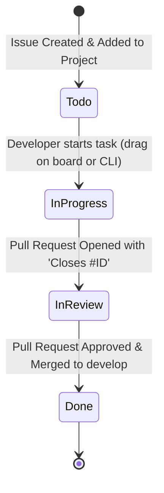

# Git and GitHub Workflow Guide for Autonomous Agents & Developers
## Academic Project: API-DATAK (Support Ticket Management MVP)

**Target Audience:** AI Agents (LLMs), Autonomous Workers, and Pair-Programming Engineers  
**Target Repositories:**
- Backend: [`AnorakTeam/tickets-datak-backend`](https://github.com/AnorakTeam/tickets-datak-backend)
- Frontend: [`AnorakTeam/tickets-datak-frontend`](https://github.com/AnorakTeam/tickets-datak-frontend)
- Project Board: [GitHub Project #1 (Tickets Datak Project)](https://github.com/users/AnorakTeam/projects/1)

---

## 1. Core Principles & Non-Negotiable Rules

When operating as an agent or engineer in this project, you **MUST** strictly adhere to the following rules:

1. **Language Separation:**
   - **Technical artifacts (English):** Code, comments, commit messages, branch names, PR titles, issue descriptions, and documentation must be written in **English**.
   - **User Interface (Spanish):** All end-user-facing texts (UI labels, placeholders, buttons, error messages, toast notifications, chatbot dialogues, and transactional email bodies) must be written in clear, professional **Spanish**.
2. **Branching Base:**
   - All feature and fix branches **MUST** branch off `develop` and merge back into `develop`.
   - Never branch directly off or merge into `main` during sprint development. `main` is strictly reserved for sprint release freezes.
3. **STRICT NO-SQUASH MERGE POLICY:**
   - **Forbidden:** `Squash and merge`.
   - **Mandatory:** Always use **"Create a merge commit"** (`git merge --no-ff`).
   - *Rationale:* Individual commits represent academic traceability and individual contributor evaluations. Squashing destroys commit history and timestamps.

---

## 2. Role Boundaries & Developer Permission Matrix

Agents acting on behalf of team members must respect the CODEOWNERS boundaries:

| GitHub User | Name & Role | Permitted Repositories | Work Scope |
| :--- | :--- | :--- | :--- |
| `@AnorakTeam` | José Manuel Pérez (DevOps / PM) | `tickets-datak-backend`<br>`tickets-datak-frontend` | Scaffolding, Docker, CI/CD, Nitro proxy, code review, main branch merges. |
| `@dannieltom` | Juan Torres (Tech Lead / BE) | `tickets-datak-backend` only | Core models (Empresa, Usuario, Ticket 20 fields, TicketItem), client ticket endpoints. |
| `@sansviex` | Giovanny Muñoz (Backend Dev) | `tickets-datak-backend` only | Catalogs (ModuloContratado), seed data, atomic radicado sequence, email dispatcher, report endpoint. |
| `@juandiegosb` | Juan Sarmiento (Coord / FE) | `tickets-datak-frontend` only | Pinia auth store, route guards, Login view, base layout, 'Mis tickets' table and detail view. |
| `@CamiloGarcia11` | Camilo García (Frontend Dev) | `tickets-datak-frontend` only | Module selector component, incident report form, radicado modal, chatbot drawer and flows. |
| `@tohond` | Omar Palencia (QA / Cross-Dev) | `tickets-datak-backend`<br>`tickets-datak-frontend` | Chatbot state machine, Pytest isolation tests, Postman collection, Vitest suite, UAT. |

---

## 3. Branch Naming Conventions

All branches must follow the standard naming structure:
```
<type>/<task-id>-<kebab-case-description>
```

### Allowed Branch Types:
- `feat/`: New feature implementation (maps to user stories or tasks).
- `fix/`: Bug fix or patch on `develop`.
- `chore/`: Configuration, dependencies, tooling, or scaffolding.
- `test/`: Adding or refactoring unit, component, or E2E tests.
- `refactor/`: Code improvement without changing public API behavior.

### Concrete Examples:
```bash
# Correct Branch Names:
feat/be-02-empresa-model
feat/be-05-ticket-model-20-fields
feat/fe-04-login-layout
feat/fe-06-incident-report-form
test/be-16-pytest-multi-tenant-isolation
chore/be-01-scaffolding-postgres-docker

# Incorrect Branch Names:
my-branch                       # Missing type prefix and task ID
fe-04                           # Missing type prefix and description
FEAT/BE-02-Empresa              # Do not use uppercase
feat/login                      # Missing task ID
```

---

## 4. Commit Message Standards (Conventional Commits)

Commit messages must follow the [Conventional Commits](https://www.conventionalcommits.org/) specification in **English**:

```
<type>(<scope>): <imperative summary>

[optional body explaining context or rationale]

[optional footer: Closes #<issue-number>]
```

### Allowed Types:
- `feat`: A new feature for the user or API.
- `fix`: A bug fix.
- `docs`: Documentation updates only.
- `style`: Formatting, missing semicolons, linter fixes (no logic change).
- `refactor`: Refactoring code without fixing a bug or adding a feature.
- `test`: Adding missing tests or correcting existing tests.
- `chore`: Tooling, Docker, dependencies, CI configuration.

### Allowed Scopes:
- **Backend:** `empresa`, `usuario`, `auth`, `modulos`, `tickets`, `ticket-item`, `radicado`, `email`, `chatbot`, `fixtures`, `ci`.
- **Frontend:** `auth`, `layout`, `router`, `tickets`, `form`, `modal`, `chatbot`, `api-client`, `tests`.

### Commit Message Rules:
1. Use the **imperative mood** in the subject line (`add`, `implement`, `fix`; NOT `added`, `implements`, `fixing`).
2. Do not capitalize the first letter of the subject line.
3. Do not place a period (`.`) at the end of the subject line.
4. Keep the subject line under 72 characters.

### Examples:
```bash
# Good Commits:
feat(tickets): implement Ticket model with exact 20 domain fields
feat(auth): add custom Usuario model and JWT token endpoint
feat(modulos): create ModuleSelect Vue component with loading state
fix(radicado): prevent race condition with atomic select_for_update
test(multi-tenancy): add pytest suite for cross-tenant 404 isolation
chore(docker): configure postgres 16 in docker-compose.yml

# Bad Commits:
Fixed bug                               # Too vague, not imperative, capitalized
feat: Added the form for reports.      # Past tense, capitalized, trailing period
WIP                                     # Never use WIP in committed branch history
```

---

## 5. Automated GitHub Project Lifecycle

The GitHub Project board automates card movements when specific Git events happen. Agents must understand this state machine to prevent manual inconsistencies.



### Step-by-Step State Transitions:

| Column | Trigger Event | Responsible Actor | Action Required |
| :--- | :--- | :--- | :--- |
| **`Todo`** | Initial state upon task creation. | Project Automation | None. Task is waiting in backlog. |
| **`In Progress`** | Developer picks up the task and starts working. | **Developer / Agent (Manual)** | Before writing code, drag the card to `In Progress` in the UI, or execute the CLI command below. |
| **`In Review`** | Pull Request opened against `develop`. | **GitHub Automation (Automatic)** | Ensure the PR body contains `Closes #<issue-number>`. GitHub links the issue and automatically moves it to `In Review`. |
| **`Done`** | Pull Request is merged into `develop`. | **GitHub Automation (Automatic)** | When merged with a merge commit (`--no-ff`), GitHub automatically closes the issue and moves the card to `Done`. |

If any issue occurs when the transitions don't occur, it must be notified to the user and then notified to the board manager, @AnorakTeam

#### CLI Command to Move Task to `In Progress`:
```bash
# e.g. Project ID: PVT_kwHOB4geDs4Bq369 | Status Field: PVTSSF_lAHOB4geDs4Bq369zhpNEps | In Progress Option: 47fc9ee4
gh project item-edit --id <ITEM_ID> --project-id PVT_kwHOB4geDs4Bq369 --field-id PVTSSF_lAHOB4geDs4Bq369zhpNEps --single-select-option-id 47fc9ee4
```

---

## 6. Pull Request Protocol & Definition of Done

When opening a Pull Request:

1. **Target Branch:** Always target `develop`.
2. **PR Title Format:**
   ```
   [<REPO>-TASK] <TASK-ID>: <Concise description> (Closes #<issue-number>)
   ```
   *Examples:*
   - `[BE-TASK] BE-02: Implement Empresa tenant model and migrations (Closes #15)`
   - `[FE-TASK] FE-04: Implement Login view and responsive layout (Closes #17)`

3. **Mandatory PR Body Template (`.github/pull_request_template.md`):**
   The PR description **MUST** fill all sections of the repository template:

```markdown
## Summary
Implemented the Empresa model with fields: nombre, nit (unique), activa, created_at, updated_at.
Added database migrations and isolated model unit tests.

## Related Issue / Task
Closes #15

## Type of Change
- [x] `feat`: New feature or user story implementation
- [ ] `fix`: Bug fix
- [ ] `chore`: Maintenance, dependencies, tooling, or configuration
- [ ] `test`: Unit or integration tests added/updated

## Technical Checklist (Definition of Done)
- [x] Code follows team conventions and all commit messages, branch names, and PR titles are written in **English**.
- [x] Multi-tenant isolation verified: all client-facing queries are strictly scoped by `empresa_id`.
- [x] Client serializers strictly omit internal management data (`responsable_id`, internal notes).
- [x] Immutability enforced: no `UPDATE` or `DELETE` endpoints exposed for `TicketItem` audit records.
- [x] Database migrations are checked and tested cleanly (`python manage.py makemigrations --check`).
- [x] Unit & integration tests added/updated with `pytest` (test coverage >= 80%).
- [x] Code formatted and linted (`ruff check .` / `ruff format .`).
- [x] **STRICT NO SQUASH MERGE**: Merge method must be set to **"Create a merge commit"** (`--no-ff`).

## Reviewer Assignment (Code Owner)
- Assigned Code Owner: @AnorakTeam
```

4. **Merging the Pull Request:**
   - Wait for CI checks (tests, linter) to pass green.
   - Obtain at least 1 Code Owner approval.
   - Merge using:
     ```bash
     gh pr merge <PR-NUMBER> --merge --repo <OWNER/REPO>
     # NEVER pass --squash or --rebase
     ```

---

## 7. Complete Agent Execution Playbook (Copy-Paste CLI Protocol)

When an AI Agent is tasked with executing a task (e.g., `BE-02`, Issue `#15`):

```bash
# -------------------------------------------------------------
# STEP 1: Navigate to repository and ensure clean develop state
# -------------------------------------------------------------
cd path/to/repo/e.g./tickets-datak-backend
git checkout develop
git pull origin develop

# -------------------------------------------------------------
# STEP 2: Move Task to 'In Progress' in GitHub Project
# -------------------------------------------------------------
# Note: You can do this in the UI or via gh CLI:
# gh project item-edit --id <ITEM_ID> --project-id PVT_kwHOB4geDs4Bq369 --field-id PVTSSF_lAHOB4geDs4Bq369zhpNEps --single-select-option-id 47fc9ee4

# -------------------------------------------------------------
# STEP 3: Create and checkout feature branch
# -------------------------------------------------------------
git checkout -b feat/be-02-empresa-model

# -------------------------------------------------------------
# STEP 4: Implement the code and run local verification
# -------------------------------------------------------------
# (Write models, migrations, tests, documentation)
pytest
ruff check .

# -------------------------------------------------------------
# STEP 5: Stage and commit with Conventional Commits
# -------------------------------------------------------------
git status
git add apps/companies/models.py apps/companies/migrations/ apps/companies/tests/
git commit -m "feat(empresa): implement Empresa tenant model and unit tests"

# -------------------------------------------------------------
# STEP 6: Push branch to remote
# -------------------------------------------------------------
git push origin feat/be-02-empresa-model

# -------------------------------------------------------------
# STEP 7: Create Pull Request with 'Closes #15' (Triggers 'In Review')
# -------------------------------------------------------------
gh pr create \
  --base develop \
  --head feat/be-02-empresa-model \
  --title "[BE-TASK] BE-02: Implement Empresa tenant model and migrations (Closes #15)" \
  --body "## Summary
Implemented the Empresa model with fields: nombre, nit (unique), activa, created_at, updated_at.
Added database migrations and model unit tests.

## Related Issue / Task
Closes #15

## Type of Change
- [x] feat: New feature or user story implementation

## Technical Checklist (Definition of Done)
- [x] Code in English, UI text in Spanish.
- [x] Multi-tenancy isolation respected.
- [x] STRICT NO SQUASH MERGE required.

## Reviewer Assignment
- Assigned Code Owner: @AnorakTeam"

# -------------------------------------------------------------
# STEP 8: Merge PR with Merge Commit (Triggers 'Done' & closes issue)
# -------------------------------------------------------------
# Once approved by Code Owner:
gh pr merge --merge --repo AnorakTeam/tickets-datak-backend
# The issue #15 will close automatically and move to Done on the Project Board!
```

---

## 8. Summary of Trigger Keywords

To ensure GitHub properly links issues to Pull Requests and fires the project automation, always use one of these keywords immediately followed by `#<issue-number>` in the PR description:
- `Closes #15`
- `Fixes #15`
- `Resolves #15`

*Do NOT write:* `Related to #15`, `Addresses #15`, or `Ref #15` (these do not automatically close the issue or move the project item to Done).
