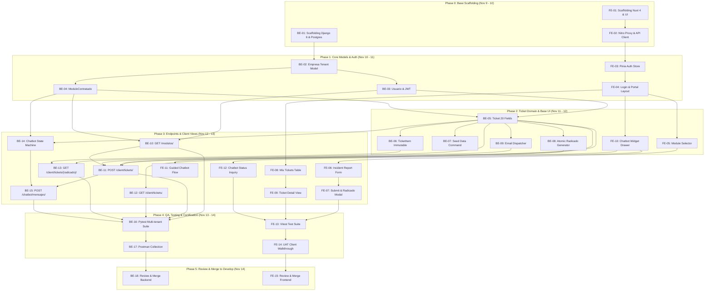

# Project Planning, Task Breakdown & Execution Schedule
## Support Ticket Management MVP — API-DATAK (2026-2)

**Version:** 1.0 · **Date:** November 9, 2026  
**Academic Course:** Administration of Information Projects (API) — Group A  
**Primary Deliverable:** E1 (Software MVP — Iterations 1 & 2)  
**Repositories:**
- Backend: [`AnorakTeam/tickets-datak-backend`](https://github.com/AnorakTeam/tickets-datak-backend)
- Frontend: [`AnorakTeam/tickets-datak-frontend`](https://github.com/AnorakTeam/tickets-datak-frontend)
- Management Board: [GitHub Project #1 (Tickets Datak Project)](https://github.com/users/AnorakTeam/projects/1)

---

## 1. Team Directory, Official Roles & Repository Permissions

In accordance with course guidelines and the `CODEOWNERS` configuration, responsibilities and permissions are distributed as follows:

| Team Member | GitHub Username | Official Role | Permitted Repositories | Core Responsibilities |
| :--- | :--- | :--- | :--- | :--- |
| **José Manuel Pérez** | `@AnorakTeam` | Project Manager / DevOps | **Both repos** (Backend & Frontend) | Base scaffolding, Docker, CI/CD, Nitro proxy configuration, code reviews, and final develop/main merges. |
| **Juan Diego Torres** | `@dannieltom` | Tech Lead / Backend Dev | **Backend only** | Core data models (Empresa, Usuario, Ticket 20 fields, TicketItem immutable) and client ticket endpoints. |
| **Giovanny Muñoz** | `@sansviex` | Backend Developer | **Backend only** | Contracted modules, seed test fixtures, atomic radicado generator, email service, and report endpoints. |
| **Juan Sarmiento** | `@juandiegosb` | Coordinator / Frontend Dev | **Frontend only** | Pinia auth store, navigation guards, Login view, portal base layout, 'Mis tickets' dashboard table, and detail view. |
| **Camilo García** | `@CamiloGarcia11` | Frontend Developer | **Frontend only** | Contracted modules selector component, incident report form view, radicado modal, and Chatbot drawer/flows. |
| **Omar Palencia** | `@tohond` | QA Lead / Cross-Stack Dev | **Both repos** (Backend & Frontend QA) | Chatbot dialogue state machine, Pytest multi-tenant isolation suite, Postman collection, Vitest suite, and UAT. |

---

## 2. Master Milestone Schedule & Critical Deadlines (Target: Freeze Nov 18, Delivery Nov 19)

The project timeline is structured to freeze all software development for both iterations on **November 18**, allowing **November 19 (4 days before the official software defense deadline)** to be dedicated exclusively to client demonstration, formal UAT acceptance sign-off, and presentation preparation.

| Period | Milestone / Focus | Scope & Deliverables |
| :--- | :--- | :--- |
| **Nov 9 – Nov 14** | **Iteration 1 (HU-01: RF1 to RF6)** | **Client Portal & Chatbot Services.** Base setup for Django 6 and Nuxt 4, complete 20-field Ticket database schema, JWT auth, incident reporting form, ticket inquiry table, and chatbot flow. Concludes with Pytest and Vitest test suites. |
| **Nov 15 – Nov 18** | **Iteration 2 (HU-02 & HU-03: RF7 to RF16)** | **Internal Support Console.** Unified inbox with multi-tenant filters, triage/classification, engineer assignment, agent reporting on behalf of client, internal notes, resolution, and in-portal notifications. |
| **Wednesday Nov 18 (23:59)** | 🛑 **DEVELOPMENT CODE FREEZE** | All Iteration 1 & 2 code merged into `main`. Automated test suite passing at 100%. |
| **Thursday Nov 19** | 🎯 **CLIENT MILESTONE (4 days before)** | Formal client demonstration, User Acceptance Testing (UAT) execution, and **Client Acceptance Certificate signing**. |
| **Friday Nov 20 (12:15 PM)** | 📝 **WRITTEN EXAM PREVIO 3** | In-class examination on **Earned Value Management (EVM) and Critical Path Method (CPM)** (team studies with software finished). |
| **Nov 21 – Nov 22** | 📄 **Engineering Documentation** | Final compilation of `FP-15 Documento_ingenieril final` (Development, Testing, and Deployment chapters) with signed acceptance certificate. |
| **Nov 23 – Nov 27** | 🚀 **Software Defenses** | Technical presentation and live demonstration of functional requirements to the course professor. |
| **Monday Nov 30 (10:00 AM)** | 📦 **Administrative Commitments** | Upload of project management bundle to NPLAD platform (`API-DATAK.mpp`, `FP5`, `FP11`, `FP14`, `FP16-IA`). |

---

## 3. Backend Task Matrix — Iteration 1 ([`tickets-datak-backend`](https://github.com/AnorakTeam/tickets-datak-backend))

| Task ID | Issue | Assignee | Technical Scope & Deliverables | Dependencies | Target Dates |
| :--- | :---: | :--- | :--- | :--- | :---: |
| **BE-01** | [#14](https://github.com/AnorakTeam/tickets-datak-backend/issues/14) | `@AnorakTeam` | Django 6 setup with UV/requirements, modular app layout, `.env.example`, `docker-compose.yml` for local PostgreSQL 16, CORS headers, and base SimpleJWT settings. | *(None - Start)* | Nov 09 – Nov 10 |
| **BE-02** | [#15](https://github.com/AnorakTeam/tickets-datak-backend/issues/15) | `@dannieltom` | Multi-tenant core entity `Empresa` with fields `nombre`, `identificacion` (unique NIT), `activa`, timestamps, migrations, and model unit tests. | BE-01 | Nov 10 – Nov 11 |
| **BE-03** | [#16](https://github.com/AnorakTeam/tickets-datak-backend/issues/16) | `@dannieltom` | Custom `Usuario` model (roles `cliente`, `agente_soporte`, `responsable_atencion`, FK to `Empresa`) and JWT endpoints `/api/v1/auth/token/`. | BE-02 | Nov 10 – Nov 11 |
| **BE-04** | [#17](https://github.com/AnorakTeam/tickets-datak-backend/issues/17) | `@sansviex` | Catalog model `ModuloContratado` (`codigo`, `nombre`, `activo`), FK to `Empresa`, and constraint `unique_together (empresa, codigo)`. | BE-02 | Nov 10 – Nov 11 |
| **BE-05** | [#18](https://github.com/AnorakTeam/tickets-datak-backend/issues/18) | `@dannieltom` | Primary `Ticket` model with **exact 20 domain fields**, status choices (`Abierto`, `En gestion`, `Resuelto`, `No procedente`), priorities, and origin channels. | BE-03, BE-04 | Nov 11 – Nov 12 |
| **BE-06** | [#19](https://github.com/AnorakTeam/tickets-datak-backend/issues/19) | `@dannieltom` | Audit trail model `TicketItem` overriding `save()` on update and `delete()` to enforce strictly immutable, insert-only audit event logging. | BE-05 | Nov 11 – Nov 12 |
| **BE-07** | [#20](https://github.com/AnorakTeam/tickets-datak-backend/issues/20) | `@sansviex` | Management command `python manage.py seed_data` generating 2 test companies, client and support users, modules, and initial tickets. | BE-05, BE-06 | Nov 11 – Nov 12 |
| **BE-08** | [#21](https://github.com/AnorakTeam/tickets-datak-backend/issues/21) | `@sansviex` | Domain service `RadicadoSequenceService` with database row lock (`select_for_update`) generating consecutive annual IDs `TK-AAAA-NNNNNN` safely. | BE-05 | Nov 11 – Nov 12 |
| **BE-09** | [#22](https://github.com/AnorakTeam/tickets-datak-backend/issues/22) | `@sansviex` | Transactional email dispatcher sending ticket receipt confirmations with radicado number and summary to the reporting client. | BE-05 | Nov 11 – Nov 12 |
| **BE-10** | [#23](https://github.com/AnorakTeam/tickets-datak-backend/issues/23) | `@sansviex` | Endpoint `GET /api/v1/modulos/` (RF2) listing exclusively the active contracted modules of the authenticated client's company. | BE-03, BE-04 | Nov 12 – Nov 13 |
| **BE-11** | [#24](https://github.com/AnorakTeam/tickets-datak-backend/issues/24) | `@sansviex` | Endpoint `POST /api/v1/client/tickets/` (RF1) for portal incident creation; validates module, generates radicado, creates initial `TicketItem`, and dispatches email. | BE-05, BE-08, BE-09, BE-10 | Nov 12 – Nov 13 |
| **BE-12** | [#25](https://github.com/AnorakTeam/tickets-datak-backend/issues/25) | `@dannieltom` | Endpoint `GET /api/v1/client/tickets/` (RF4) for 'Mis tickets'; scoped to company, sorted `Abierto` first, supports `?estado=` filter and pagination. | BE-05 | Nov 12 – Nov 13 |
| **BE-13** | [#26](https://github.com/AnorakTeam/tickets-datak-backend/issues/26) | `@dannieltom` | Endpoint `GET /api/v1/client/tickets/{radicado}/` (RF5); secure client serializer exposing solution text while strictly hiding assigned developer and internal notes. | BE-05, BE-06 | Nov 12 – Nov 13 |
| **BE-14** | [#27](https://github.com/AnorakTeam/tickets-datak-backend/issues/27) | `@tohond` | Conversational state machine service for Chatbot (guided incident reporting and radicado status inquiry flows). | BE-04, BE-05 | Nov 12 – Nov 13 |
| **BE-15** | [#28](https://github.com/AnorakTeam/tickets-datak-backend/issues/28) | `@tohond` | Endpoint `POST /api/v1/chatbot/mensajes/` (RF3, RF6) processing messages, driving the state machine, and creating tickets or returning status cards. | BE-11, BE-14 | Nov 12 – Nov 13 |
| **BE-16** | [#29](https://github.com/AnorakTeam/tickets-datak-backend/issues/29) | `@tohond` | Automated Pytest test suite asserting multi-tenant isolation (cross-tenant 404 responses) and `TicketItem` immutability (RNF2, RNF8). | BE-10 to BE-15 | Nov 13 – Nov 14 |
| **BE-17** | [#30](https://github.com/AnorakTeam/tickets-datak-backend/issues/30) | `@tohond` | Documented Postman Collection with environments (`dev`, `staging`), pre-request auth scripts, and automated functional assertions. | BE-16 | Nov 13 – Nov 14 |
| **BE-18** | [#31](https://github.com/AnorakTeam/tickets-datak-backend/issues/31) | `@AnorakTeam` | Final backend code review, merge commit verification, CI validation, and merge into `develop`. | BE-16, BE-17 | Nov 14 – Nov 14 |

---

## 4. Frontend Task Matrix — Iteration 1 ([`tickets-datak-frontend`](https://github.com/AnorakTeam/tickets-datak-frontend))

| Task ID | Issue | Assignee | Technical Scope & Deliverables | Dependencies | Target Dates |
| :--- | :---: | :--- | :--- | :--- | :---: |
| **FE-01** | [#14](https://github.com/AnorakTeam/tickets-datak-frontend/issues/14) | `@AnorakTeam` | Nuxt 4 scaffolding, Tailwind CSS, Nuxt UI, TypeScript, Pinia, and directory layout (`pages/`, `components/`, `stores/`, `composables/`). | *(None - Start)* | Nov 09 – Nov 10 |
| **FE-02** | [#15](https://github.com/AnorakTeam/tickets-datak-frontend/issues/15) | `@AnorakTeam` | Nitro proxy configuration (`/api/**` pointing to Django port 8000) and authenticated `$fetch` composable (`useApiClient`) with JWT token handling. | FE-01 | Nov 09 – Nov 10 |
| **FE-03** | [#16](https://github.com/AnorakTeam/tickets-datak-frontend/issues/16) | `@juandiegosb` | Pinia store `useAuthStore` (login, logout, user profile, role, cookie persistence) and Nuxt navigation middleware (`auth.ts`) for private route guards. | FE-02 | Nov 10 – Nov 11 |
| **FE-04** | [#17](https://github.com/AnorakTeam/tickets-datak-frontend/issues/17) | `@juandiegosb` | Login view (`/login`) and responsive Client Portal base layout (`layouts/default.vue`) with sidebar, user badge, company badge, and logout. | FE-03 | Nov 10 – Nov 11 |
| **FE-05** | [#18](https://github.com/AnorakTeam/tickets-datak-frontend/issues/18) | `@CamiloGarcia11` | Reusable component `ModuleSelect.vue` (RF2) querying `GET /api/v1/modulos/` with loading skeleton, search filter, and error empty state. | FE-04 | Nov 11 – Nov 12 |
| **FE-06** | [#19](https://github.com/AnorakTeam/tickets-datak-frontend/issues/19) | `@CamiloGarcia11` | Incident reporting form view (`/tickets/nuevo`, RF1) with module select, screen input, subject, description, error, and priority dropdown. | FE-05 | Nov 12 – Nov 13 |
| **FE-07** | [#20](https://github.com/AnorakTeam/tickets-datak-frontend/issues/20) | `@CamiloGarcia11` | Form submission handler to `POST /api/v1/client/tickets/` and confirmation modal `RadicadoModal.vue` with copy button and redirect. | FE-06 | Nov 12 – Nov 13 |
| **FE-08** | [#21](https://github.com/AnorakTeam/tickets-datak-frontend/issues/21) | `@juandiegosb` | Dashboard 'Mis tickets' (`/tickets`, RF4); responsive data table with radicado, subject, module, status badge, date, status filters, and pagination. | FE-04 | Nov 12 – Nov 13 |
| **FE-09** | [#22](https://github.com/AnorakTeam/tickets-datak-frontend/issues/22) | `@juandiegosb` | Client Ticket Detail view (`/tickets/[radicado]`, RF5); status timeline, incident fields, and solution card (hiding internal notes). | FE-08 | Nov 12 – Nov 13 |
| **FE-10** | [#23](https://github.com/AnorakTeam/tickets-datak-frontend/issues/23) | `@CamiloGarcia11` | Bottom floating action button and collapsible Chatbot drawer (`ChatbotWidget.vue`, RF3, RF6) with bubble history and input field. | FE-04 | Nov 11 – Nov 12 |
| **FE-11** | [#24](https://github.com/AnorakTeam/tickets-datak-frontend/issues/24) | `@CamiloGarcia11` | Guided conversational chat flow connected to `POST /api/v1/chatbot/mensajes/`, interactive summary card, and radicado confirmation. | FE-10 | Nov 12 – Nov 13 |
| **FE-12** | [#25](https://github.com/AnorakTeam/tickets-datak-frontend/issues/25) | `@CamiloGarcia11` | Interactive ticket status inquiry card rendered in Chatbot when client enters a radicado, displaying current state and solution summary. | FE-10 | Nov 12 – Nov 13 |
| **FE-13** | [#26](https://github.com/AnorakTeam/tickets-datak-frontend/issues/26) | `@tohond` | Vitest unit and component test suite covering `useAuthStore`, form validations, `ModuleSelect`, and chatbot drawer rendering. | FE-07, FE-09, FE-12 | Nov 13 – Nov 14 |
| **FE-14** | [#27](https://github.com/AnorakTeam/tickets-datak-frontend/issues/27) | `@tohond` | End-to-End User Acceptance Test (UAT) walkthrough execution and documentation of client workflow acceptance report. | FE-13 | Nov 13 – Nov 14 |
| **FE-15** | [#28](https://github.com/AnorakTeam/tickets-datak-frontend/issues/28) | `@AnorakTeam` | Final frontend code review, responsive layout audit, Spanish copy verification, and merge into `develop`. | FE-13, FE-14 | Nov 14 – Nov 14 |

---

## 5. Phased Operational Execution Flow

---

## 6. Core Quality and Development Standards

1. **Classification Labels:**
   - Label `user-story` (green `#0E8A16`): High-level requirement items (HU-01, HU-02, HU-03).
   - Label `task` (blue `#1D76DB`): Technical engineering tasks tracked in the active Kanban view.
2. **Project Lifecycle Automations:**
   - Move from `Todo` to `In Progress` when work begins.
   - PR opened with `Closes #XX` automatically transitions card to `In Review`.
   - PR merged via merge commit automatically transitions card to `Done`.
3. **Strict No-Squash Policy:**
   - All merges must use **"Create a merge commit"** (`--no-ff`). Never squash or rebase into `develop` or `main`.
